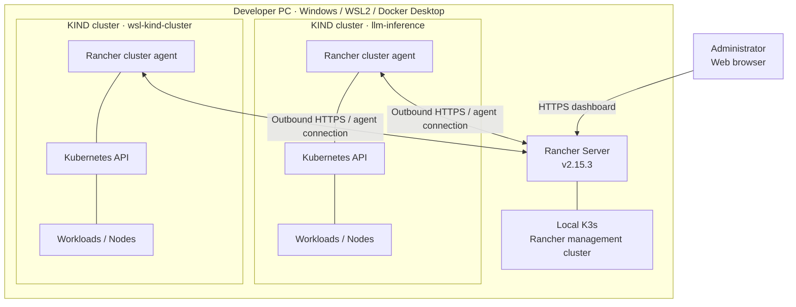

# Rancher Multi-Cluster Kubernetes Management Lab

A hands-on local DevOps lab demonstrating how to manage two independent KIND Kubernetes clusters from one Rancher dashboard.

## Project overview

This project uses Rancher as a centralized Kubernetes management platform. Two existing KIND clusters are imported into Rancher and managed from a single web interface.

The Rancher dashboard screenshot in [`docs/images/rancher-clusters.png`](docs/images/rancher-clusters.png) shows:

| Cluster | Role | Kubernetes version | Rancher state |
|---|---|---:|---|
| `local` | Rancher's local K3s management cluster | `v1.36.5+k3s1` | Active |
| `kind-llm-inference` | Imported downstream cluster | `v1.37.0` | Active |
| `wsl-kind-cluster` | Imported downstream cluster | `v1.36.1` | Active |

The local K3s cluster is part of the Rancher management environment. The two imported clusters are the downstream environments this lab aims to manage.

## Architecture



A standalone Mermaid source file is available at [`docs/architecture.mmd`](docs/architecture.mmd).

## Goals

- Run a local Rancher management server for a learning environment.
- Connect Rancher to two separate KIND Kubernetes clusters.
- Import existing clusters rather than recreate them.
- Verify that both clusters can reach the Rancher endpoint.
- View cluster health, nodes, namespaces, workloads, and events centrally.
- Practice multi-cluster administration using Rancher.

## Lab environment

Based on the completed lab and the Rancher dashboard:

- Rancher version shown in the dashboard: `v2.15.3`
- Rancher deployment: Docker container (local lab)
- Management Kubernetes environment: Rancher's local K3s cluster
- Downstream clusters: `kind-llm-inference` and `wsl-kind-cluster`
- Client environment: Windows PC with WSL2 and Docker Desktop
- Rancher server URL configured during the lab: `https://172.22.48.1`

> **Networking note:** `172.22.48.1` was the address tested successfully from both cluster environments in this lab. It is a local WSL/network gateway address and may change after Docker Desktop or WSL restarts. Do not assume it is a permanent address. For a repeatable setup, use a stable hostname/IP that both downstream clusters can resolve and reach, and configure a TLS certificate trusted by the cluster agents.

> **Security note:** The connectivity test used `curl -k`, which skips TLS certificate verification. A successful `/ping` response proves network reachability, not that the TLS certificate is trusted. For a secure/reproducible setup, configure a valid certificate and avoid disabling certificate verification in production.

## High-level implementation

### 1. Check local Kubernetes contexts

List the contexts available in the kubeconfig:

```bash
kubectl config get-contexts
```

List KIND clusters:

```bash
kind get clusters
```

Inspect each target cluster (use the actual context names in your environment):

```bash
kubectl --context kind-llm-inference get nodes -o wide
kubectl --context kind-local-cluster get nodes -o wide
```

The context name and the display name shown in Rancher do not have to be identical. Use the context that points to the intended cluster when applying its import manifest.

### 2. Run Rancher for a local test lab

The lab used the Rancher Docker installation approach. A typical command is:

```bash
docker run -d \
  --name rancher-server \
  --restart=unless-stopped \
  --privileged \
  -p 80:80 \
  -p 443:443 \
  rancher/rancher:stable
```

Check container status and logs:

```bash
docker ps
docker logs -f rancher-server
```

Open the dashboard at:

```text
https://localhost
```

For initial login, retrieve the bootstrap password using the method documented for the Rancher image/version you installed. Keep credentials out of source control.

> This Docker-based Rancher installation is intended for development, testing, and demonstration. It is not a production Rancher deployment architecture.

### 3. Configure the Rancher server URL

In Rancher, open **☰ → Global Settings → `server-url`** and configure an address reachable by the downstream cluster agents.

In this lab, the tested value was:

```text
https://172.22.48.1
```

Do not copy this value blindly into another environment. Confirm the address from the cluster network and plan for address stability before importing clusters. Changing `server-url` after clusters have been registered can disrupt their agent connections; configure it before importing clusters whenever possible.

### 4. Verify connectivity from both clusters

The lab verified the Rancher `/ping` endpoint from both KIND clusters:

```bash
kubectl --context kind-llm-inference run rancher-test \
  --image=curlimages/curl \
  --restart=Never \
  --rm -it \
  -- curl -kfsS --connect-timeout 10 https://172.22.48.1/ping
```

```bash
kubectl --context kind-local-cluster run rancher-test \
  --image=curlimages/curl \
  --restart=Never \
  --rm -it \
  -- curl -kfsS --connect-timeout 10 https://172.22.48.1/ping
```

Expected response:

```text
pong
```

The `-k` option is used here only to reproduce the lab's connectivity check with its local certificate. It does not validate certificate trust.

### 5. Import the existing clusters into Rancher

For each downstream cluster:

1. Open Rancher **Cluster Management**.
2. Select **Import Existing**.
3. Choose the generic Kubernetes import option offered by your Rancher version.
4. Enter a descriptive cluster name.
5. Create the cluster entry.
6. Copy the registration command/manifest generated by Rancher.
7. Switch `kubectl` to the intended downstream cluster context.
8. Apply the exact registration manifest generated by your Rancher dashboard.

Example context selection:

```bash
kubectl config use-context kind-llm-inference
```

Apply the generated command from Rancher (do not substitute a guessed URL):

```bash
kubectl apply -f <RANCHER-GENERATED-REGISTRATION-MANIFEST>
```

Repeat for the second cluster using its own context and its own generated registration manifest.

Check the agent namespace in each downstream cluster:

```bash
kubectl --context kind-llm-inference get pods -n cattle-system
kubectl --context kind-local-cluster get pods -n cattle-system
```

The exact agent pod names and components can vary by Rancher release.

### 6. Verify from Rancher and kubectl

In Rancher **Cluster Management**, verify that both imported clusters reach the **Active** state.

Inspect nodes and workloads independently:

```bash
kubectl --context kind-llm-inference get nodes -o wide
kubectl --context kind-local-cluster get nodes -o wide
```

```bash
kubectl --context kind-llm-inference get pods -A
kubectl --context kind-local-cluster get pods -A
```

The completed dashboard evidence is included in this repository under `docs/images/`.

## What this demonstrates

- Kubernetes context and multi-cluster awareness.
- KIND-based local Kubernetes environments.
- Rancher installation and initial configuration.
- Importing existing Kubernetes clusters into Rancher.
- Cluster-agent connectivity and troubleshooting.
- Centralized visibility of cluster state and workloads.
- Practical networking considerations across WSL2 and Docker Desktop.

## Troubleshooting notes

### Cluster does not become Active

Check:

```bash
kubectl --context <CONTEXT> get pods -n cattle-system
kubectl --context <CONTEXT> get events -n cattle-system --sort-by=.lastTimestamp
```

Confirm that the cluster can reach the configured Rancher server URL on TCP 443. Test the URL from the cluster network, not only from the host browser.

### `/ping` works but the agent cannot connect

A successful `curl -k` test confirms basic network reachability only. Check:

- The `server-url` is the same reachable endpoint the agents are expected to use.
- DNS resolution works from the cluster nodes/pods if a hostname is used.
- TCP 443 is reachable in both directions required by the Rancher agent architecture.
- The TLS certificate SAN matches the configured hostname/IP.
- The certificate chain is trusted by the agent.
- The Rancher server and cluster-agent logs for the actual TLS or registration error.

### Fleet/system chart initialization errors

Inspect Rancher's management environment and logs before changing resources:

```bash
docker logs --tail 300 rancher-server
```

If Rancher is running with an internal Kubernetes environment accessible through `kubectl` inside the container:

```bash
docker exec rancher-server kubectl get pods -A
docker exec rancher-server kubectl get configmaps -A
docker exec rancher-server kubectl get crds | grep -i fleet
```

Do not manually create Fleet ConfigMaps, delete system namespaces, or remove CRDs without identifying the root cause.

## Repository structure

```text
rancher-multicluster-lab/
├── README.md
└── docs/
    ├── architecture.mmd
    └── images/
        └── rancher-clusters.png
```

## Future improvements

- Replace the temporary WSL gateway address with a stable endpoint.
- Configure trusted TLS certificates for Rancher.
- Add a repeatable KIND cluster creation configuration.
- Deploy a sample application to both clusters.
- Add monitoring and centralized observability.
- Demonstrate Fleet GitOps deployments across both clusters.
- Add automated validation scripts for cluster connectivity.

## Disclaimer

This is a personal learning and demonstration lab. Adapt networking, TLS, access control, resource sizing, and deployment architecture before using Rancher in production.

## References

- [Rancher documentation](https://ranchermanager.docs.rancher.com/)
- [Rancher installation](https://ranchermanager.docs.rancher.com/getting-started/installation-and-upgrade)
- [Import existing clusters](https://ranchermanager.docs.rancher.com/how-to-guides/new-user-guides/kubernetes-clusters-in-rancher-setup/register-existing-clusters)
- [KIND documentation](https://kind.sigs.k8s.io/)
